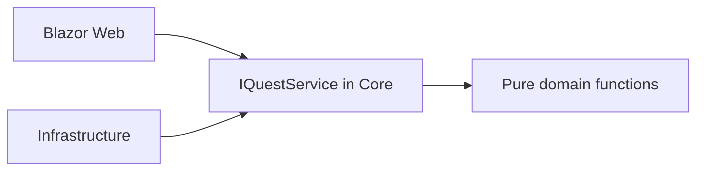

# Architecture Overview

`QuestForge.Core` has no dependency on the UI or database. Pure functions calculate rewards, levels, immutable next states, and achievements. Infrastructure owns mutable state and side effects. Web uses dependency injection and only depends on the Core contract.

`EfQuestService` is the PostgreSQL adapter. It uses `AsNoTracking` for read queries, pagination and indexes for bounded reads, a unique XP-transaction index for idempotency, optimistic concurrency via PostgreSQL `xmin`, and one database transaction covering quest status, player XP, skill XP, history, and achievements. `InMemoryQuestService` remains only as a fast test double.
